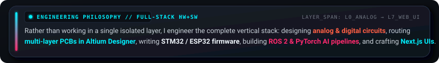
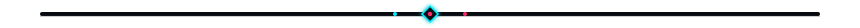
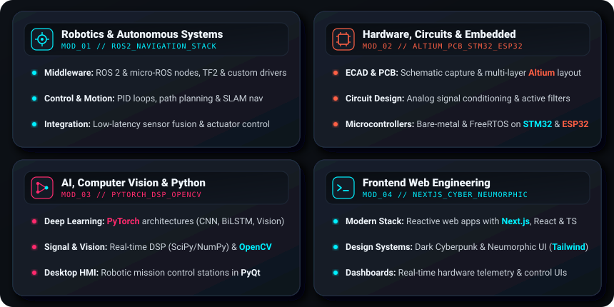
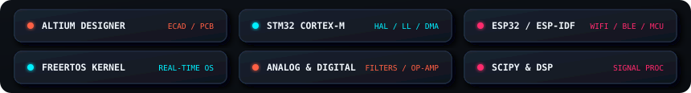
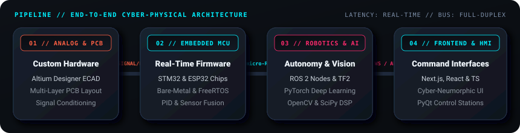

  <!-- Cyberpunk × Dark Neumorphism Hero Chassis -->
  

  <!-- Animated Terminal Telemetry Sub-Header -->
  

  <!-- Tactile Contact & Command Links -->
  

    
    
    
  

<!-- Neumorphic Philosophy Callout Console -->

  

  

### `// 01` CORE ENGINEERING PILLARS

  

  

### `// 02` TECH STACK & HARDWARE ARSENAL

  <!-- Visual Icon Dock (Skillicons) -->
  

    
  

  <!-- Custom Neumorphic Hardware & EE Keys -->
  

    
  

  

### `// 03` SYSTEM ARCHITECTURE PIPELINE

   Microcontrollers -> Robotics & AI -> Frontend & HMI" />

  

### `// 04` GITHUB TELEMETRY & ACTIVITY

  

  
  

