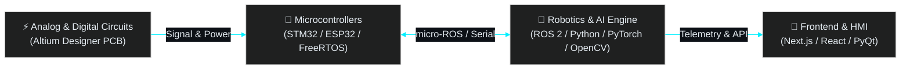

  <!-- Animated Hero Header -->
  

  

    <b>Full-Spectrum Engineer — Building from Analog Circuits & Custom PCBs to Autonomous Robots, AI Models & Web Interfaces</b>
  

  <!-- Contact & Quick Links -->
  

    
    
    
  

---

> [!IMPORTANT]
> **⚡ Engineering Philosophy:** Rather than working in a single isolated layer, I design the **analog & digital electronics**, route the **multi-layer PCB in Altium Designer**, write the **STM32/ESP32 microcontroller firmware**, develop the **ROS 2 & Python/PyTorch AI pipelines**, and craft the **modern Frontend UI**.

---

### 🧩 Core Engineering Pillars

<table>
  <tr>
    <td width="50%" valign="top">
      <h3>🤖 Robotics & Autonomous Systems</h3>
      <ul>
        <li><b>Middleware:</b> ROS 2 & micro-ROS node architecture, TF2 & custom drivers</li>
        <li><b>Control & Motion:</b> PID control loops, path planning & autonomous navigation</li>
        <li><b>Integration:</b> Low-latency sensor fusion & actuator control</li>
      </ul>
    </td>
    <td width="50%" valign="top">
      <h3>⚡ Hardware, Circuits & Embedded</h3>
      <ul>
        <li><b>ECAD & PCB:</b> Schematic capture & multi-layer PCB layout in <b>Altium Designer</b></li>
        <li><b>Circuit Design:</b> Analog signal conditioning, active filters & digital logic</li>
        <li><b>Microcontrollers:</b> Bare-metal & FreeRTOS firmware on <b>STM32</b> & <b>ESP32</b></li>
      </ul>
    </td>
  </tr>
  <tr>
    <td width="50%" valign="top">
      <h3>🧠 AI, Computer Vision & Python</h3>
      <ul>
        <li><b>Deep Learning:</b> Model architecture & training with <b>PyTorch</b> (CNN, BiLSTM, Vision)</li>
        <li><b>Signal & Vision:</b> Real-time DSP (SciPy/NumPy) & image processing with <b>OpenCV</b></li>
        <li><b>Desktop HMI:</b> Industrial & robotic control stations built with <b>Python & PyQt</b></li>
      </ul>
    </td>
    <td width="50%" valign="top">
      <h3>🎨 Frontend Web Engineering</h3>
      <ul>
        <li><b>Modern Frameworks:</b> Responsive web apps with <b>Next.js</b>, <b>React</b> & <b>TypeScript</b></li>
        <li><b>UI/UX Styling:</b> Custom Dark-Mode, Cyberpunk & Neumorphic interfaces with <b>Tailwind CSS</b></li>
        <li><b>Dashboards:</b> Real-time web telemetry & interactive user platforms</li>
      </ul>
    </td>
  </tr>
</table>

---

### 🛠️ Tech Stack & Hardware Arsenal

  <!-- Visual Icon Dock (Skillicons) -->
  

    
  

  <!-- Specialized Hardware & EE Badges -->
  

    
    
    
    
    
    
  

---

### 🛰️ System Architecture Workflow

---

### 📊 GitHub Telemetry & Activity

  

  
  

